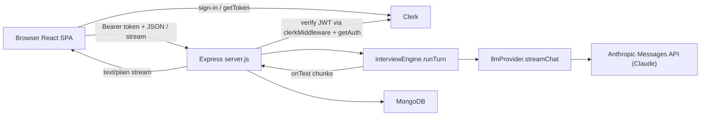

# System flow map

**Last verified against commit `d4c7de2` + uncommitted D-031 security hardening.**  
Read with [DECISIONS.md](./DECISIONS.md) (why) and [CONTEXT.md](./CONTEXT.md) (product rules).

---

## 1. Repo map

| Path | Job |
|------|-----|
| `CONTEXT.md` | Product source of truth + documentation rules |
| `DECISIONS.md` | Why we chose designs (decision log) |
| `FLOW.md` | How requests move (this file) |
| `package.json` | Root `npm run dev` / `npm run seed` via concurrently |
| `client/` | Vite + React SPA |
| `client/src/main.jsx` | ClerkProvider bootstrap |
| `client/src/App.jsx` | Landing, session list, interview orchestration, streaming |
| `client/src/components/Chat.jsx` | Chat UI, phase badge, start/stop/end |
| `client/src/components/Canvas.jsx` | React Flow canvas, palette, debounced autosave |
| `client/src/components/canvas/*` | Typed nodes, palette, node config |
| `client/src/components/DiagramDebugPanel.jsx` | Dev-only “what the interviewer sees” |
| `client/src/components/Sidebar.jsx` | Past sessions + new interview |
| `client/src/components/ProblemPicker.jsx` | Choose problem → preview it (session is created on Start) |
| `client/src/lib/api.js` | `apiFetch` / `apiJson` with Bearer token |
| `client/src/lib/razorpay.js` | Lazy-load Razorpay Checkout; `openCheckout(order)` |
| `server/server.js` | Express app, CORS, Clerk, mounts routes |
| `server/config.js` | Env load + fail-fast required vars |
| `server/db.js` | `connectDb()` Mongoose connection |
| `server/middleware/requireAuth.js` | API 401 gate + `getUserId` |
| `server/prompts.js` | Persona, phases, tools, `buildSystemPrompt` |
| `server/routes/sessions.js` | Problems + session CRUD/end |
| `server/routes/interview.js` | Streaming interview turn + persistence |
| `server/routes/billing.js` | Premium pass: status, create order, verify payment |
| `server/services/paymentProvider.js` | Only module that talks to Razorpay (`createOrder`, `verifyPaymentSignature`) |
| `server/services/entitlements.js` | `getEntitlement`, idempotent `grantPremiumPass`, `reconcilePaidOrders`, `canAccessProblem` |
| `server/services/billing.test.js` | Unit tests for signature verification + pass expiry math |
| `server/services/interviewEngine.js` | Transport-agnostic `runTurn` (no vendor SDK) |
| `server/services/llmProvider.js` | Only module importing `@anthropic-ai/sdk`; `streamChat`, `generateJson` |
| `server/services/diagramSerializer.js` | Validate, slim, summary, observations, diff, promptBlock |
| `server/services/evaluator.js` | Real evaluator: one-shot Claude structured-output (JSON schema) call scored against the brief |
| `server/services/evaluator.test.js` | Unit tests for `normalizeEvaluation` response-shape validation |
| `client/src/lib/theme.js` | `useTheme` hook: localStorage-persisted dark/light theme |
| `server/models/Session.js` | Session schema + index |
| `server/models/Problem.js` | Problem brief schema (+ `tier: free \| premium`) |
| `server/models/User.js` | Entitlement per Clerk user (`premiumUntil`, `appliedOrderIds`) |
| `server/models/Payment.js` | One row per Razorpay order (`created` → `paid`) |
| `server/lib/diagram.js` | Last snapshot + equality helpers |
| `server/lib/rateLimit.js` | In-memory sliding window |
| `server/seed/problems.js` | Hand-written briefs: 3 free, 3 premium |
| `server/seed/seed.js` | Idempotent upsert by slug |

---

## 2. System overview



---

## 3. Auth flow

```mermaid
sequenceDiagram
  participant U as User
  participant App as App.jsx / main.jsx
  participant Clerk as Clerk
  participant API as Express /api
  participant MW as requireAuth / getUserId

  U->>App: Sign in (SignInButton)
  App->>Clerk: ClerkProvider session
  App->>Clerk: getToken()
  Clerk-->>App: JWT string
  App->>API: Authorization: Bearer JWT
  Note over API: clerkMiddleware() unless DEV_AUTH_USER_ID
  API->>MW: requireAuth
  MW->>MW: getAuth(req) or DEV_AUTH_USER_ID
  alt no userId
    MW-->>App: 401 JSON
  else ok
    MW-->>API: next(); getUserId(req)
    API-->>App: handler response
  end
```

**How `userId` reaches handlers**

1. Client: `useAuth().getToken()` in `InterviewApp` (`client/src/App.jsx`).
2. Client: `apiFetch` / `apiJson` set `Authorization: Bearer ${token}` (`client/src/lib/api.js`).
3. Server: `clerkMiddleware()` on all routes after `/health` when `DEV_AUTH_USER_ID` is unset (`server/server.js`). `config.js` refuses to boot if `DEV_AUTH_USER_ID` is set with `NODE_ENV=production`.
4. Server: `app.use('/api', requireAuth)` (`server/middleware/requireAuth.js`).
5. Handlers call `getUserId(req)` and pass that into every `Session.find*` filter. Never from `req.body`.

---

## 4. Interview turn (end to end)

### 4a. Sequence diagram

```mermaid
sequenceDiagram
  participant Chat as Chat.jsx
  participant App as App.runInterviewTurn
  participant API as interview.js route
  participant RL as rateLimit
  participant DB as Session / Problem
  participant Eng as runTurn
  participant Prompts as buildSystemPrompt
  participant LLM as llmProvider.streamChat
  participant Gem as Claude API

  Chat->>App: onSend(text) or onStart('')
  App->>App: getToken(); AbortController
  App->>API: POST /api/sessions/:id/interview
  API->>RL: rateLimit(interview:userId)
  API->>DB: Session.findOne({_id, userId})
  API->>DB: Problem.findOne({slug})
  API->>Eng: runTurn({session, problem, userText, diagram, onText})
  Eng->>Prompts: buildSystemPrompt(...)
  Eng->>LLM: streamChat({systemInstruction, messages, tools})
  LLM->>Gem: beta.messages.stream (system + user/assistant messages, fallbacks: default)
  loop chunks
    Gem-->>LLM: chunk.text
    LLM-->>Eng: onText(chunk)
    Eng-->>API: onText(chunk)
    API-->>App: res.write(chunk)
    App-->>Chat: setStreamingText
  end
  LLM-->>Eng: functionCalls? advance_phase (text only persisted)
  Eng-->>API: {assistantText, phaseAdvanced, nextPhase}
  API->>DB: persistTurn (messages + maybe session.phase)
  API-->>App: res.end()
  App->>API: GET /api/sessions/:id
  App->>Chat: session + phase badge
```

### 4b. Numbered walkthrough (one user message)

1. **Keypress / Send** — `Chat.handleSubmit` (`client/src/components/Chat.jsx`) calls `onSend(text)`.
2. **Orchestration** — `InterviewApp.runInterviewTurn` (`client/src/App.jsx`) sets streaming state, creates `AbortController`.
3. **Token** — `const token = await getToken()` (Clerk).
4. **HTTP body** — `apiFetch('/api/sessions/' + session._id + '/interview', { method:'POST', token, body: JSON.stringify({ message, diagram }), signal })` (`client/src/lib/api.js` + `App.jsx`).
5. **Middleware** — `requireAuth` → `getUserId(req)` (`server/middleware/requireAuth.js`).
6. **Route** — `router.post('/sessions/:id/interview')` (`server/routes/interview.js`).
7. **Rate limit** — `rateLimit({ key: 'interview:'+userId, limit:30, windowMs:60000 })` (`server/lib/rateLimit.js`).
8. **Validate message** — length ≤ 4000; empty only allowed if `session.messages.length === 0`.
9. **Load session** — `Session.findOne({ _id: req.params.id, userId })`. Missing → 404.
10. **Guards** — status must be `active`; `messages.length < 60`.
11. **Load problem** — `Problem.findOne({ slug: session.problemSlug }).lean()` (full brief, server-only).
12. **Diagram** — `slimDiagram(req.body.diagram ?? session.diagram)` (`server/lib/diagram.js`).
13. **Capture phase** — `phaseAtTurn = session.phase` (used for this turn’s messages).
14. **Stream headers** — `Content-Type: text/plain`; wire `req` close → `abortController.abort()`.
14b. **Diagram serialize** — `buildDiagramContext(rawDiagram, previousSnapshot)` (`diagramSerializer.js`) → `promptBlock` + `slimJson` + `persistedDiagram`. Invalid diagram → **400**.
15. **Engine** — `runTurn` (`server/services/interviewEngine.js`):
    - `buildSystemPrompt({ problem, phase, diagramPromptBlock: promptBlock })` (`server/prompts.js`)
    - `streamChat` in `llmProvider.js` sends history as Claude `user`/`assistant` messages with the system prompt in `system` (model `ANTHROPIC_MODEL`, default `claude-sonnet-5-5`, effort `low`), streams text deltas, and returns `advance_phase` `tool_use` blocks as `functionCalls` only when `stop_reason` is `tool_use`. A `refusal` (after the server-side fallback also declines) is returned as `refused: true`; the engine then substitutes a short redirect line and does not advance the phase
    - Each text delta → `onText` → `res.write` (assistant history stores text only)
16. **Phase tool** — If `advance_phase` present and not wrapup, `nextPhase(session.phase)` (`prompts.js`). **Phase field on session is not used for this reply’s prompt** (already built).
17. **Persist** — `persistTurn` in `interview.js`:
    - Push user message (`content`, `phase: phaseAtTurn`, optional `diagramSnapshot` if changed)
    - Push assistant message (**text only**)
    - If advanced: set `assistantMsg.event = { type:'phase_advanced', detail }` and **`session.phase = nextPhaseName`** (applies next turn)
    - `session.save()`
18. **Client after stream** — `loadSession(id)` + `refreshSessions()`; Chat shows phase badge from `session.phase`.

---

## 5. Data at each hop

**A. Client → API (interview)**

```json
{
  "message": "We need ~100M users and low latency redirects.",
  "diagram": { "nodes": [], "edges": [] }
}
```

Headers: `Authorization: Bearer <clerk_jwt>`, `Content-Type: application/json`.

**B. After `slimDiagram` (server)**

```json
{
  "nodes": [{ "id": "n1", "type": "cache", "label": "Redis" }],
  "edges": [{ "source": "n1", "target": "n2" }]
}
```

**C. Claude request (llmProvider)** — stored roles map 1:1; system prompt separate:

```js
client.beta.messages.stream({
  model: "claude-sonnet-5-5",
  max_tokens: 16000,
  output_config: { effort: "low" },
  system: "...string from buildSystemPrompt(...)",
  messages: [
    { role: "user", content: "[Interview start]" },
    { role: "assistant", content: "Let's design a URL shortener..." },
    { role: "user", content: "We need ~100M users..." }
  ],
  tools: [{ ...ADVANCE_PHASE_TOOL, eager_input_streaming: true }], // omitted in wrapup
  betas: ["server-side-fallback-2026-07-01"],
  fallbacks: "default"
}, { signal })
```

Thinking blocks in the response are never stored or replayed (assistant history is text only, D-008).

**D. Stream to browser** — raw `text/plain` chunks (not JSON):

```text
Before we pick stores — what latency target are you aiming for?
```

**E. Persisted messages (Mongo)**

```json
{
  "role": "user",
  "content": "We need ~100M users...",
  "phase": "requirements",
  "diagramSnapshot": { "nodes": [], "edges": [] },
  "at": "2026-10-17T07:00:00.000Z"
}
```

```json
{
  "role": "assistant",
  "content": "Before we pick stores — what latency target...",
  "phase": "requirements",
  "event": { "type": "phase_advanced", "detail": "requirements -> estimation: clarified NFRs" },
  "at": "2026-10-17T07:00:05.000Z"
}
```

After save, `session.phase` may be `"estimation"` while both messages still record `"requirements"`.

**F. Client refetch `GET /api/sessions/:id`**

```json
{
  "session": {
    "_id": "...",
    "userId": "user_abc",
    "problemSlug": "url-shortener",
    "phase": "estimation",
    "status": "active",
    "messages": [ "...as above..." ],
    "diagram": { "nodes": [], "edges": [] }
  },
  "problem": {
    "slug": "url-shortener",
    "title": "URL Shortener",
    "difficulty": "easy",
    "prompt": "Design a URL shortener..."
  }
}
```

Private brief fields (`hiddenRequirements`, etc.) are **not** in `problem` here (`publicProblem` in `sessions.js`).

---

## 6. Every other route / script

### `GET /health` — `server/server.js`

- **Who:** ops / smoke tests (no auth).
- **Validates:** nothing.
- **Reads/writes:** none.
- **Returns:** `{ ok: true }`.

### `GET /api/me` — `server/server.js`

- **Who:** early auth probe (was M1); any signed-in client.
- **Validates:** `requireAuth`.
- **Returns:** `{ userId }`.

### `GET /api/problems` — `sessions.js` `router.get('/problems')`

- **Who:** `InterviewApp.loadProblems` → ProblemPicker.
- **Validates:** auth only.
- **Reads:** `Problem.find().select('slug title difficulty tier prompt')` + `getEntitlement(userId)`.
- **Returns:** `{ problems: [{ slug, title, difficulty, tier, prompt, locked }] }` (no hidden brief fields). `locked` is true for premium problems without an active pass.

### `POST /api/sessions` — `sessions.js`

- **Who:** `handleStart` in `App.jsx`, when the candidate clicks "Start interview" (picking a problem only previews it, D-027). The first `/interview` turn follows immediately.
- **Validates:** `problemSlug` required; problem must exist; `canAccessProblem(problem, getEntitlement(userId))` else **402** `{ code: 'premium_required' }`. Gated here only — existing sessions keep working after a pass expires.
- **Quota:** after the premium check, `claimInterviewSlot` atomically increments today's `DailyUsage` row if `count < limit` (1 free / 3 premium); otherwise **429** `{ code: 'daily_limit', usage: { limit, used, remaining, resetsAt } }`. If `Session.create` then fails, the slot is released (D-029).
- **Writes:** new `Session` (`phase: requirements`, `status: active`, empty messages, `timeLimitMinutes` from the user's tier: `FREE_SESSION_MINUTES` default 15, `PREMIUM_SESSION_MINUTES` default 30).
- **Returns:** `201 { session, problem: publicProblem, timer }`. `timer` is `{ limitMinutes, remainingMs }` from `sessionTimer.js`; `remainingMs` is null until the first turn sets `startedAt`.

### `GET /api/sessions` — `sessions.js`

- **Who:** `refreshSessions` / Sidebar.
- **Reads:** `Session.find({ userId }, { ..., messageCount: { $size: '$messages' } }).sort({ createdAt: -1 })`. Sessions with `messageCount: 0` (opening turn failed) show as "not started" so they can be resumed without using another daily slot (D-029).
- **Returns:** `{ sessions }`.

### `GET /api/sessions/:id` — `sessions.js`

- **Who:** `loadSession` after turns / resume.
- **Reads:** session by `_id` + `userId`; public problem fields.
- **Returns:** `{ session, problem, timer }` or `404`. The client turns `timer.remainingMs` into a local deadline (so the user's clock skew doesn't matter), shows a countdown, and calls `/end` itself when it reaches 0, after any streaming reply finishes.

### `DELETE /api/sessions/:id` — `sessions.js`

- **Who:** Sidebar trash icon → `handleDeleteSession` in `App.jsx` (after a `confirmToast` confirmation; the app uses react-toastify for all notices and confirms, never native dialogs). Hidden for the session that is mid-turn or being scored, since those requests would save into a deleted document.
- **Writes:** `Session.deleteOne({ _id, userId })` — hard delete, no undo.
- **Returns:** `{ deleted: true }`, or **404** if it isn't the caller's session. If the open session was deleted, the client returns to the problem picker.

### `PATCH /api/sessions/:id/diagram` — `sessions.js`

- **Who:** Canvas debounced autosave (~1.5s) in `Canvas.jsx`.
- **Validates:** ownership; session `active`; `buildDiagramContext` validation (≤60 nodes, known types, etc.).
- **Writes:** `session.diagram = persistedDiagram` (positions kept for restore).
- **Returns:** `{ session: { _id, diagram, updatedAt } }`.

### `GET /api/sessions/:id/diagram-context` — `sessions.js` (dev only)

- **Who:** `DiagramDebugPanel` when `import.meta.env.DEV`.
- **Validates:** disabled if `NODE_ENV === 'production'` (404); ownership otherwise.
- **Returns:** `{ promptBlock, summaryText, observationsText, diffText, slimJson }` for the saved diagram vs last snapshot.

### `POST /api/sessions/:id/end` — `sessions.js`

- **Who:** Chat “End interview” → `handleEnd`, or the time-limit auto-end.
- **Validates:** the final `req.body.diagram` (if any) via `buildDiagramContext` **before** claiming, so a bad payload can't half-end the session.
- **Claim (atomic):** `findOneAndUpdate({ _id, userId, status: 'active' }, { status: 'evaluating', evaluationStartedAt: now, diagram })`. Only one request can win, so double clicks, two tabs, or auto-end racing the button score once (D-030).
- **Returns:** winner → **202** `{ session }` (status `evaluating`) immediately, then `evaluationJob.startEvaluation` runs in the background. Loser / already ended → **200** `{ session }` as it is now. Not yours → **404**.
- **Background job** (`server/services/evaluationJob.js` → `evaluateSession` in `evaluator.js`): one Claude call (`llmProvider.generateJson`, effort `high`, JSON schema) over the private brief, transcript and final diagram summary/observations, validated by `normalizeEvaluation`. Success → `status: completed`, `evaluation`. Any failure (API error, refusal, bad shape) → `status: completed`, `evaluationError` (no placeholder scores). Both writes are conditional on `status: 'evaluating'`.
- **Client:** while the open session is `evaluating`, App polls `GET /sessions/:id` every 3s; on completion it shows the feedback card and a toast, or the error with "Try scoring again".
- **Turns vs end:** `persistTurn` writes with `updateOne({ _id, status: 'active' }, { $push, $set })`, so a reply that finishes after the end is dropped instead of landing after the score.
- **Restart safety:** job state lives in Mongo. `GET /sessions/:id` on an `evaluating` session older than 5 minutes atomically re-claims it (`claimStaleEvaluation`) and restarts the job.

### `POST /api/sessions/:id/evaluate` — `sessions.js`

- **Who:** "Try scoring again" on a failed score → `handleRetryScoring`.
- **Claim:** `{ status: 'completed', evaluationError: { $ne: null } }` → `evaluating`, then the same background job. **202** `{ session }`.
- **Otherwise:** already scored or a retry already running → **200** current session; still `active` → **409**; not yours → **404**.

### `POST /api/sessions/:id/interview` — see §4

### `GET /api/billing/status` — `billing.js`

- **Who:** `InterviewApp.loadBilling` → ProblemPicker banner.
- **Writes:** `reconcilePaidOrders` first — grants any of this user's `paid` Payments missing from `User.appliedOrderIds` (heals a verify that died after marking the payment paid).
- **Reads:** `User.findOne({ userId })`.
- **Returns:** `{ isPremium, premiumUntil, billingEnabled, sessionMinutes, pass: { amount, currency, days } }` (amount in paise, from server config). `sessionMinutes` is the time limit a new interview would get, shown before Start. Also `interviews: { day, limit, used, remaining, resetsAt }` (today's quota, read-only) and `premiumDailyInterviews` for the upsell text.

### `POST /api/billing/order` — `billing.js`

- **Who:** `handleUpgrade` in `App.jsx` (Get premium / Unlock buttons).
- **Validates:** billing configured (else **503**); rate limit 5/min per user (**429**). Body is ignored — amount and days come from `config`.
- **Writes:** Razorpay order via `paymentProvider.createOrder`; `Payment { status: 'created' }`.
- **Returns:** `201 { orderId, amount, currency, keyId }` → client opens Razorpay Checkout (`lib/razorpay.js`).

### `POST /api/billing/verify` — `billing.js`

- **Who:** `handleUpgrade`, with Checkout's success payload `{ razorpay_order_id, razorpay_payment_id, razorpay_signature }`.
- **Validates:** order exists **for this user** (else 404); HMAC-SHA256 signature of `order_id|payment_id` with the key secret (else **400**).
- **Writes:** `Payment` `created → paid` (no-op if already paid); then `grantPremiumPass(userId, orderId, passDays)` — one atomic pipeline update that sets `User.premiumUntil = max(now, premiumUntil) + passDays` and pushes `orderId` onto `appliedOrderIds`, only if that order isn't applied yet. A replayed verify returns the current entitlement without extending; a retried verify after a failure still grants.
- **Returns:** `{ isPremium, premiumUntil }`; client then reloads billing status + problems.

### `npm run seed` → `server/seed/seed.js`

- **Who:** developer CLI (`package.json` → `server` seed script).
- **Validates:** requires same env as server (`config.js` via `connectDb`).
- **Writes:** `Problem.findOneAndUpdate({ slug }, problem, { upsert: true })` for each brief in `seed/problems.js` (including `tier`).
- **Returns:** console logs; exit 0. Idempotent.

---

## 7. Error and edge paths

| Case | Behavior |
|------|----------|
| Claude API fails **before** any chunk | `interview.js` catch → `502 { error: 'Interview model call failed' }` if headers not sent as success body (cause is logged server-side, never sent). **No** user/assistant messages saved. |
| Claude API fails / connection drops **after** chunks | Partial `streamedText` saved via `persistTurn` (no phase advance). Response ended. |
| Client **Stop** / abort | `AbortController` → fetch abort → `req` close → SDK request `signal` aborts the Claude stream. `runTurn` returns `aborted: true`. Route still `persistTurn` with text so far; `phaseAdvanced` forced false. Client refetches session. |
| Someone else’s session id | `findOne({ _id, userId })` → `null` → **404** `{ error: 'Session not found' }` on get/interview/end. |
| Malformed session id (not an ObjectId) | `router.param('id', validateSessionId)` → **404** `{ error: 'Session not found' }` before any query. |
| Unknown `/api` route | **404** JSON `{ error: 'Not found' }`. |
| Uncaught error in a handler | Global handler in `server.js`: 5xx → logged, `{ error: 'Internal server error' }`; 4xx (e.g. malformed JSON body) → status kept, JSON `{ error }`. |
| Message > 4000 chars | **400** before LLM. |
| Empty message after interview started | **400** `Message cannot be empty`. |
| `messages.length >= 60` | **400** turn limit. |
| Daily interview limit reached | `POST /sessions` → **429** `daily_limit`; picker and Start box show when it resets. Resuming existing sessions still works. |
| Turn sent after `startedAt + timeLimitMinutes` + 15s grace | **409** `{ code: 'time_up' }`. The client treats it as time up and auto-ends (D-028). |
| Rate limit | **429** + `retryAfterMs`. |
| Session not `active` | **400** `Session is not active`. |
| Missing env at boot | `config.js` `process.exit(1)` with clear message. |
| Invalid diagram payload | **400** from serializer (`DiagramValidationError`). |
| `diagram-context` in production | **404**. |
| Premium problem without an active pass | `POST /sessions` → **402** `premium_required`; picker shows Unlock instead of Start. |
| Razorpay keys not set | App boots; `/billing/order` and `/billing/verify` → **503**; premium problems stay locked, banner hidden. |
| User closes Checkout | `openCheckout` resolves `null`; nothing written beyond the `created` Payment row. |
| Bad / forged payment signature | `/billing/verify` → **400**; no entitlement change. |
| Server dies after `Payment` → `paid`, before the `User` grant | Healed automatically: next `GET /billing/status` runs `reconcilePaidOrders` and applies the order once. |
| Browser closes after paying, before `/verify` | **Known gap (D-025):** charged but not upgraded; `Payment` stays `created`. No webhook yet — reconcile manually. |

---

## 8. State map

| State | Where it lives | Who may change it |
|-------|----------------|-------------------|
| Clerk session / JWT | Clerk + browser | User via Clerk UI; `getToken` reads |
| `view`, `session`, `problem`, `streamingText`, `isStreaming`, `sessions[]`, `problems[]` | React state in `App.jsx` | Client only (refetch overwrites from server) |
| Dark/light theme | `localStorage['theme']` (per-browser) + `<html data-theme>` | `useTheme` hook (`client/src/lib/theme.js`) via the header toggle |
| `session.phase`, `status`, `messages`, `diagram`, `evaluation` | Mongo `Session` | Server routes (`interview`, `PATCH diagram`, `end`, create) |
| Canvas local nodes/edges | React Flow state in `Canvas.jsx` | User draws; autosave patches server |
| Slim `diagramSnapshot` on user messages | Mongo message field | Interview persist when slim changed |
| `Problem` briefs (incl. `tier`) | Mongo `Problem` | Seed script (upsert); not mutated by interview API |
| Premium entitlement (`premiumUntil`) | Mongo `User` | `grantPremiumPass` from `/billing/verify` and `reconcilePaidOrders` (`/billing/status`) |
| Razorpay orders | Mongo `Payment` + Razorpay | `/billing/order` creates; `/billing/verify` flips to `paid` |
| `billing` status, `upgrading` | React state in `App.jsx` | Client only (refetched after verify) |
| System prompt / phase instructions | Rebuilt each turn in `buildSystemPrompt` | Code in `prompts.js` (not stored) |
| Rate-limit buckets | Process memory `rateLimit.js` | Server process (lost on restart) |
| Private brief | Server memory after Problem load; never in client JSON | Seed / DB admins |

---

## 9. Quick index — “I want to change X”

| Goal | Files |
|------|--------|
| Interviewer personality / hard rules | `server/prompts.js` → `BASE_PERSONA` |
| Phase goals / exit criteria | `server/prompts.js` → `PHASE_BLOCKS`, `toolsForPhase` |
| When phase advances (tool schema) | `server/prompts.js` → `ADVANCE_PHASE_TOOL`; detection in `interviewEngine.js` |
| Claude model or API key | `server/config.js`, `server/.env` / `.env.example` (`ANTHROPIC_API_KEY`, `ANTHROPIC_MODEL`); default `claude-sonnet-5-5` |
| Streaming / abort / Anthropic SDK | `server/services/llmProvider.js` |
| Phase advance + turn assembly | `server/services/interviewEngine.js` |
| Persist rules / guardrails | `server/routes/interview.js`, `server/lib/rateLimit.js`, `server/lib/diagram.js` |
| Add a problem | `server/seed/problems.js` (set `tier`) then `npm run seed`; schema in `models/Problem.js` |
| Premium price / pass length | `PREMIUM_PASS_PRICE_PAISE`, `PREMIUM_PASS_DAYS` in `server/.env` (`server/config.js`) |
| Payment flow / Razorpay calls | `server/routes/billing.js`, `server/services/paymentProvider.js`, `client/src/lib/razorpay.js` |
| Who can open which problem | `server/services/entitlements.js` → `canAccessProblem`; enforced in `sessions.js` create route |
| Session fields / index | `server/models/Session.js` |
| Auth / ownership | `server/middleware/requireAuth.js`, session queries in `routes/*.js` |
| Evaluator rubric / scoring prompt | `server/services/evaluator.js`, `server/prompts.js` → `buildEvaluationPrompt`, `EVALUATOR_PERSONA`; called from `sessions.js` end route |
| Dark/light theme | `client/src/lib/theme.js`, `client/src/index.css` (`@custom-variant dark`), `client/index.html` (pre-hydration script), toggle in `App.jsx` |
| Chat UX / phase badge | `client/src/components/Chat.jsx` |
| Streaming client loop | `client/src/App.jsx` → `runInterviewTurn` |
| API helpers | `client/src/lib/api.js` |
| Canvas / node types / autosave | `client/src/components/Canvas.jsx`, `canvas/*` |
| Diagram → LLM text | `server/services/diagramSerializer.js` |
| Dev diagram preview | `DiagramDebugPanel.jsx`, `GET .../diagram-context` |
| Problem picker / sidebar | `ProblemPicker.jsx`, `Sidebar.jsx` |
| CORS / port / mount order | `server/server.js`, `server/config.js` |
