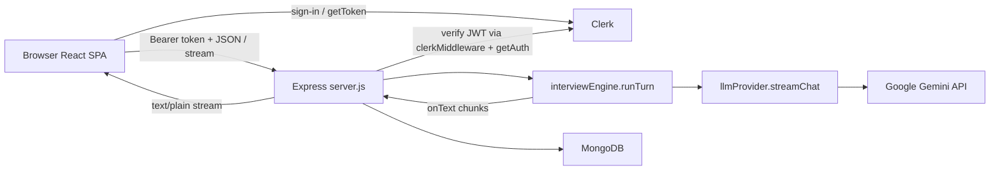

# System flow map

**Last verified against commit `f801f94`.**  
Read with [DECISIONS.md](./DECISIONS.md) (why) and [CONTEXT.md](./CONTEXT.md) (product rules).

---

## 1. Repo map

| Path | Job |
|------|-----|
| `CONTEXT.md` | Product source of truth + documentation rules |
| `DECISIONS.md` | Why we chose designs (decision log) |
| `FLOW.md` | How requests move (this file) |
| `package.json` | Root `npm run dev` / `npm run seed` via concurrently |
| `client/` | Vite + React SPA |
| `client/src/main.jsx` | ClerkProvider bootstrap |
| `client/src/App.jsx` | Landing, session list, interview orchestration, streaming |
| `client/src/components/Chat.jsx` | Chat UI, phase badge, start/stop/end |
| `client/src/components/Canvas.jsx` | React Flow canvas, palette, debounced autosave |
| `client/src/components/canvas/*` | Typed nodes, palette, node config |
| `client/src/components/DiagramDebugPanel.jsx` | Dev-only “what the interviewer sees” |
| `client/src/components/Sidebar.jsx` | Past sessions + new interview |
| `client/src/components/ProblemPicker.jsx` | Choose problem → create session |
| `client/src/lib/api.js` | `apiFetch` / `apiJson` with Bearer token |
| `server/server.js` | Express app, CORS, Clerk, mounts routes |
| `server/config.js` | Env load + fail-fast required vars |
| `server/db.js` | `connectDb()` Mongoose connection |
| `server/middleware/requireAuth.js` | API 401 gate + `getUserId` |
| `server/prompts.js` | Persona, phases, tools, `buildSystemPrompt` |
| `server/routes/sessions.js` | Problems + session CRUD/end |
| `server/routes/interview.js` | Streaming interview turn + persistence |
| `server/services/interviewEngine.js` | Transport-agnostic `runTurn` (no vendor SDK) |
| `server/services/llmProvider.js` | Only module importing `@google/genai`; `streamChat` |
| `server/services/diagramSerializer.js` | Validate, slim, summary, observations, diff, promptBlock |
| `server/services/evaluator.js` | Stub evaluation on end |
| `server/models/Session.js` | Session schema + index |
| `server/models/Problem.js` | Problem brief schema |
| `server/lib/diagram.js` | Last snapshot + equality helpers |
| `server/lib/rateLimit.js` | In-memory sliding window |
| `server/seed/problems.js` | Three hand-written briefs |
| `server/seed/seed.js` | Idempotent upsert by slug |

---

## 2. System overview



---

## 3. Auth flow

```mermaid
sequenceDiagram
  participant U as User
  participant App as App.jsx / main.jsx
  participant Clerk as Clerk
  participant API as Express /api
  participant MW as requireAuth / getUserId

  U->>App: Sign in (SignInButton)
  App->>Clerk: ClerkProvider session
  App->>Clerk: getToken()
  Clerk-->>App: JWT string
  App->>API: Authorization: Bearer JWT
  Note over API: clerkMiddleware() unless DEV_AUTH_USER_ID
  API->>MW: requireAuth
  MW->>MW: getAuth(req) or DEV_AUTH_USER_ID
  alt no userId
    MW-->>App: 401 JSON
  else ok
    MW-->>API: next(); getUserId(req)
    API-->>App: handler response
  end
```

**How `userId` reaches handlers**

1. Client: `useAuth().getToken()` in `InterviewApp` (`client/src/App.jsx`).
2. Client: `apiFetch` / `apiJson` set `Authorization: Bearer ${token}` (`client/src/lib/api.js`).
3. Server: `clerkMiddleware()` on all routes after `/health` when `DEV_AUTH_USER_ID` is unset (`server/server.js`).
4. Server: `app.use('/api', requireAuth)` (`server/middleware/requireAuth.js`).
5. Handlers call `getUserId(req)` and pass that into every `Session.find*` filter. Never from `req.body`.

---

## 4. Interview turn (end to end)

### 4a. Sequence diagram

```mermaid
sequenceDiagram
  participant Chat as Chat.jsx
  participant App as App.runInterviewTurn
  participant API as interview.js route
  participant RL as rateLimit
  participant DB as Session / Problem
  participant Eng as runTurn
  participant Prompts as buildSystemPrompt
  participant LLM as llmProvider.streamChat
  participant Gem as Gemini API

  Chat->>App: onSend(text) or onStart('')
  App->>App: getToken(); AbortController
  App->>API: POST /api/sessions/:id/interview
  API->>RL: rateLimit(interview:userId)
  API->>DB: Session.findOne({_id, userId})
  API->>DB: Problem.findOne({slug})
  API->>Eng: runTurn({session, problem, userText, diagram, onText})
  Eng->>Prompts: buildSystemPrompt(...)
  Eng->>LLM: streamChat({systemInstruction, messages, tools})
  LLM->>Gem: generateContentStream (systemInstruction + user/model roles)
  loop chunks
    Gem-->>LLM: chunk.text
    LLM-->>Eng: onText(chunk)
    Eng-->>API: onText(chunk)
    API-->>App: res.write(chunk)
    App-->>Chat: setStreamingText
  end
  LLM-->>Eng: functionCalls? advance_phase (text only persisted)
  Eng-->>API: {assistantText, phaseAdvanced, nextPhase}
  API->>DB: persistTurn (messages + maybe session.phase)
  API-->>App: res.end()
  App->>API: GET /api/sessions/:id
  App->>Chat: session + phase badge
```

### 4b. Numbered walkthrough (one user message)

1. **Keypress / Send** — `Chat.handleSubmit` (`client/src/components/Chat.jsx`) calls `onSend(text)`.
2. **Orchestration** — `InterviewApp.runInterviewTurn` (`client/src/App.jsx`) sets streaming state, creates `AbortController`.
3. **Token** — `const token = await getToken()` (Clerk).
4. **HTTP body** — `apiFetch('/api/sessions/' + session._id + '/interview', { method:'POST', token, body: JSON.stringify({ message, diagram }), signal })` (`client/src/lib/api.js` + `App.jsx`).
5. **Middleware** — `requireAuth` → `getUserId(req)` (`server/middleware/requireAuth.js`).
6. **Route** — `router.post('/sessions/:id/interview')` (`server/routes/interview.js`).
7. **Rate limit** — `rateLimit({ key: 'interview:'+userId, limit:30, windowMs:60000 })` (`server/lib/rateLimit.js`).
8. **Validate message** — length ≤ 4000; empty only allowed if `session.messages.length === 0`.
9. **Load session** — `Session.findOne({ _id: req.params.id, userId })`. Missing → 404.
10. **Guards** — status must be `active`; `messages.length < 60`.
11. **Load problem** — `Problem.findOne({ slug: session.problemSlug }).lean()` (full brief, server-only).
12. **Diagram** — `slimDiagram(req.body.diagram ?? session.diagram)` (`server/lib/diagram.js`).
13. **Capture phase** — `phaseAtTurn = session.phase` (used for this turn’s messages).
14. **Stream headers** — `Content-Type: text/plain`; wire `req` close → `abortController.abort()`.
14b. **Diagram serialize** — `buildDiagramContext(rawDiagram, previousSnapshot)` (`diagramSerializer.js`) → `promptBlock` + `slimJson` + `persistedDiagram`. Invalid diagram → **400**.
15. **Engine** — `runTurn` (`server/services/interviewEngine.js`):
    - `buildSystemPrompt({ problem, phase, diagramPromptBlock: promptBlock })` (`server/prompts.js`)
    - `streamChat` in `llmProvider.js` maps history to Gemini `user`/`model`, puts the system prompt in `systemInstruction`, streams text, collects `functionCalls` for `advance_phase`
    - Each text delta → `onText` → `res.write` (assistant history stores text only)
16. **Phase tool** — If `advance_phase` present and not wrapup, `nextPhase(session.phase)` (`prompts.js`). **Phase field on session is not used for this reply’s prompt** (already built).
17. **Persist** — `persistTurn` in `interview.js`:
    - Push user message (`content`, `phase: phaseAtTurn`, optional `diagramSnapshot` if changed)
    - Push assistant message (**text only**)
    - If advanced: set `assistantMsg.event = { type:'phase_advanced', detail }` and **`session.phase = nextPhaseName`** (applies next turn)
    - `session.save()`
18. **Client after stream** — `loadSession(id)` + `refreshSessions()`; Chat shows phase badge from `session.phase`.

---

## 5. Data at each hop

**A. Client → API (interview)**

```json
{
  "message": "We need ~100M users and low latency redirects.",
  "diagram": { "nodes": [], "edges": [] }
}
```

Headers: `Authorization: Bearer <clerk_jwt>`, `Content-Type: application/json`.

**B. After `slimDiagram` (server)**

```json
{
  "nodes": [{ "id": "n1", "type": "cache", "label": "Redis" }],
  "edges": [{ "source": "n1", "target": "n2" }]
}
```

**C. Gemini contents (engine)** — roles remapped; system prompt separate:

```js
// config.systemInstruction = string from buildSystemPrompt(...)
contents = [
  { role: "user", parts: [{ text: "[Interview start]" }] },
  { role: "model", parts: [{ text: "Let's design a URL shortener..." }] },
  { role: "user", parts: [{ text: "We need ~100M users..." }] }
]
```

**D. Stream to browser** — raw `text/plain` chunks (not JSON):

```text
Before we pick stores — what latency target are you aiming for?
```

**E. Persisted messages (Mongo)**

```json
{
  "role": "user",
  "content": "We need ~100M users...",
  "phase": "requirements",
  "diagramSnapshot": { "nodes": [], "edges": [] },
  "at": "2026-10-17T07:00:00.000Z"
}
```

```json
{
  "role": "assistant",
  "content": "Before we pick stores — what latency target...",
  "phase": "requirements",
  "event": { "type": "phase_advanced", "detail": "requirements -> estimation: clarified NFRs" },
  "at": "2026-10-17T07:00:05.000Z"
}
```

After save, `session.phase` may be `"estimation"` while both messages still record `"requirements"`.

**F. Client refetch `GET /api/sessions/:id`**

```json
{
  "session": {
    "_id": "...",
    "userId": "user_abc",
    "problemSlug": "url-shortener",
    "phase": "estimation",
    "status": "active",
    "messages": [ "...as above..." ],
    "diagram": { "nodes": [], "edges": [] }
  },
  "problem": {
    "slug": "url-shortener",
    "title": "URL Shortener",
    "difficulty": "easy",
    "prompt": "Design a URL shortener..."
  }
}
```

Private brief fields (`hiddenRequirements`, etc.) are **not** in `problem` here (`publicProblem` in `sessions.js`).

---

## 6. Every other route / script

### `GET /health` — `server/server.js`

- **Who:** ops / smoke tests (no auth).
- **Validates:** nothing.
- **Reads/writes:** none.
- **Returns:** `{ ok: true }`.

### `GET /api/me` — `server/server.js`

- **Who:** early auth probe (was M1); any signed-in client.
- **Validates:** `requireAuth`.
- **Returns:** `{ userId }`.

### `GET /api/problems` — `sessions.js` `router.get('/problems')`

- **Who:** `InterviewApp.loadProblems` → ProblemPicker.
- **Validates:** auth only.
- **Reads:** `Problem.find().select('slug title difficulty prompt')`.
- **Returns:** `{ problems: [...] }` (no hidden brief fields).

### `POST /api/sessions` — `sessions.js`

- **Who:** `handlePickProblem` in `App.jsx`.
- **Validates:** `problemSlug` required; problem must exist.
- **Writes:** new `Session` (`phase: requirements`, `status: active`, empty messages).
- **Returns:** `201 { session, problem: publicProblem }`.

### `GET /api/sessions` — `sessions.js`

- **Who:** `refreshSessions` / Sidebar.
- **Reads:** `Session.find({ userId }).select(...).sort({ createdAt: -1 })`.
- **Returns:** `{ sessions }`.

### `GET /api/sessions/:id` — `sessions.js`

- **Who:** `loadSession` after turns / resume.
- **Reads:** session by `_id` + `userId`; public problem fields.
- **Returns:** `{ session, problem }` or `404`.

### `PATCH /api/sessions/:id/diagram` — `sessions.js`

- **Who:** Canvas debounced autosave (~1.5s) in `Canvas.jsx`.
- **Validates:** ownership; session `active`; `buildDiagramContext` validation (≤60 nodes, known types, etc.).
- **Writes:** `session.diagram = persistedDiagram` (positions kept for restore).
- **Returns:** `{ session: { _id, diagram, updatedAt } }`.

### `GET /api/sessions/:id/diagram-context` — `sessions.js` (dev only)

- **Who:** `DiagramDebugPanel` when `import.meta.env.DEV`.
- **Validates:** disabled if `NODE_ENV === 'production'` (404); ownership otherwise.
- **Returns:** `{ promptBlock, summaryText, observationsText, diffText, slimJson }` for the saved diagram vs last snapshot.

### `POST /api/sessions/:id/end` — `sessions.js`

- **Who:** Chat “End interview” → `handleEnd`.
- **Validates:** ownership; if already completed, returns as-is.
- **Writes:** `evaluateSession` stub → `status: completed`, optional diagram via serializer; `session.save()`.
- **Returns:** `{ session }` including stub `evaluation`.

### `POST /api/sessions/:id/interview` — see §4

### `npm run seed` → `server/seed/seed.js`

- **Who:** developer CLI (`package.json` → `server` seed script).
- **Validates:** requires same env as server (`config.js` via `connectDb`).
- **Writes:** `Problem.findOneAndUpdate({ slug }, problem, { upsert: true })` for each brief in `seed/problems.js`.
- **Returns:** console logs; exit 0. Idempotent.

---

## 7. Error and edge paths

| Case | Behavior |
|------|----------|
| Gemini fails **before** any chunk | `interview.js` catch → `502 { error: 'Interview model call failed', detail }` if headers not sent as success body. **No** user/assistant messages saved. |
| Gemini fails / connection drops **after** chunks | Partial `streamedText` saved via `persistTurn` (no phase advance). Response ended. |
| Client **Stop** / abort | `AbortController` → fetch abort → `req` close → `abortSignal` on Gemini. `runTurn` returns `aborted: true`. Route still `persistTurn` with text so far; `phaseAdvanced` forced false. Client refetches session. |
| Someone else’s session id | `findOne({ _id, userId })` → `null` → **404** `{ error: 'Session not found' }` on get/interview/end. |
| Message > 4000 chars | **400** before LLM. |
| Empty message after interview started | **400** `Message cannot be empty`. |
| `messages.length >= 60` | **400** turn limit. |
| Rate limit | **429** + `retryAfterMs`. |
| Session not `active` | **400** `Session is not active`. |
| Missing env at boot | `config.js` `process.exit(1)` with clear message. |
| Invalid diagram payload | **400** from serializer (`DiagramValidationError`). |
| `diagram-context` in production | **404**. |

---

## 8. State map

| State | Where it lives | Who may change it |
|-------|----------------|-------------------|
| Clerk session / JWT | Clerk + browser | User via Clerk UI; `getToken` reads |
| `view`, `session`, `problem`, `streamingText`, `isStreaming`, `sessions[]`, `problems[]` | React state in `App.jsx` | Client only (refetch overwrites from server) |
| `session.phase`, `status`, `messages`, `diagram`, `evaluation` | Mongo `Session` | Server routes (`interview`, `PATCH diagram`, `end`, create) |
| Canvas local nodes/edges | React Flow state in `Canvas.jsx` | User draws; autosave patches server |
| Slim `diagramSnapshot` on user messages | Mongo message field | Interview persist when slim changed |
| `Problem` briefs | Mongo `Problem` | Seed script (upsert); not mutated by interview API |
| System prompt / phase instructions | Rebuilt each turn in `buildSystemPrompt` | Code in `prompts.js` (not stored) |
| Rate-limit buckets | Process memory `rateLimit.js` | Server process (lost on restart) |
| Private brief | Server memory after Problem load; never in client JSON | Seed / DB admins |

---

## 9. Quick index — “I want to change X”

| Goal | Files |
|------|--------|
| Interviewer personality / hard rules | `server/prompts.js` → `BASE_PERSONA` |
| Phase goals / exit criteria | `server/prompts.js` → `PHASE_BLOCKS`, `toolsForPhase` |
| When phase advances (tool schema) | `server/prompts.js` → `ADVANCE_PHASE_TOOL`; detection in `interviewEngine.js` |
| Gemini model or API key | `server/config.js`, `server/.env` / `.env.example` (`GEMINI_*`); default `gemini-flash-latest` |
| Streaming / abort / Gemini SDK | `server/services/llmProvider.js` |
| Phase advance + turn assembly | `server/services/interviewEngine.js` |
| Persist rules / guardrails | `server/routes/interview.js`, `server/lib/rateLimit.js`, `server/lib/diagram.js` |
| Add a problem | `server/seed/problems.js` then `npm run seed`; schema in `models/Problem.js` |
| Session fields / index | `server/models/Session.js` |
| Auth / ownership | `server/middleware/requireAuth.js`, session queries in `routes/*.js` |
| Stub → real evaluator | `server/services/evaluator.js`, called from `sessions.js` end route |
| Chat UX / phase badge | `client/src/components/Chat.jsx` |
| Streaming client loop | `client/src/App.jsx` → `runInterviewTurn` |
| API helpers | `client/src/lib/api.js` |
| Canvas / node types / autosave | `client/src/components/Canvas.jsx`, `canvas/*` |
| Diagram → LLM text | `server/services/diagramSerializer.js` |
| Dev diagram preview | `DiagramDebugPanel.jsx`, `GET .../diagram-context` |
| Problem picker / sidebar | `ProblemPicker.jsx`, `Sidebar.jsx` |
| CORS / port / mount order | `server/server.js`, `server/config.js` |
